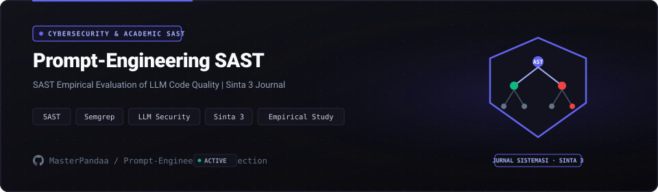

<p align="center">
  <a href="https://github.com/MasterPandaa/Prompt-Engineering-Collection">
    
  </a>
</p>

<p align="center">
  <b>Empirical SAST Security Benchmarks for Code-Generating LLMs</b>
</p>

<p align="center">
  <a href="#-quickstart"><b>⚡ Quickstart</b></a> &nbsp;&bull;&nbsp;
  <a href="#-core-features"><b>✨ Features</b></a> &nbsp;&bull;&nbsp;
  <a href="#-architecture--system-design"><b>🏛️ Architecture</b></a> &nbsp;&bull;&nbsp;
  <a href="#-benchmarks--security"><b>📊 Benchmarks</b></a> &nbsp;&bull;&nbsp;
  <a href="#-contributing"><b>🤝 Contributing</b></a>
</p>

<p align="center">
  <a href="LICENSE"></a>
  
  
  
  
</p>

---

## 📖 Overview & Entity Pitch

**Prompt-Engineering-Collection** is An empirical cybersecurity research repository evaluating vulnerability patterns in LLM-generated code across 218 prompting experiments, published in Jurnal SISTEMASI.

> [!NOTE]
> This project is maintained under the **MasterPandaa Engineering Lab** ecosystem, strictly adhering to anti-slop technical documentation standards, deterministic test verification, and clean architecture.

---

## 🌟 The Problem vs The Solution

| Dimensi | Pendekatan Konvensional | Pendekatan Prompt-Engineering-Collection |
| :--- | :--- | :--- |
| **Workflow Efficiency** | ❌ Developers blindly trust LLM code completions, inadvertently introducing OWASP Top 10 vulnerabilities into production systems. | ⚡ **Rigorous benchmark datasets comparing zero-shot, few-shot, and Chain-of-Thought prompts against Semgrep and Bandit static analysis rules.** |
| **Operational Reliability** | ⚠️ Subjective claims of LLM code safety without empirical, reproducible quantitative metrics. | 🎯 **218 standardized experiments with deterministic Bandit severity ratings, confidence levels, and CWE classifications.** |
| **Privacy & Security** | 🔓 Code models producing injection flaws, broken cryptography, and insecure deserialization patterns. | 🛡️ **Formal taxonomy of prompt patterns that consistently minimize SAST security warning densities.** |
| **Developer Experience** | 🐌 Scattered prompt research without structured reproduction scripts or peer-reviewed academic validation. | 🚀 **Reproducible Python analysis pipeline with formatted BibTeX citation for academic literature review.** |

---

## ✨ Core Features

1. **218 Empirical Experiments** (`Comparative Prompt Suite`):
   - Systematic evaluation of code generation across varied prompt engineering techniques.

2. **Static Analysis Security Testing** (`Semgrep & Bandit SAST`):
   - Automated vulnerability scanning scoring generated code on High, Medium, and Low risk thresholds.

3. **CWE Vulnerability Taxonomy** (`MITRE CWE Mapping`):
   - Maps generated vulnerabilities to CWE-89 (SQLi), CWE-79 (XSS), CWE-78 (Command Injection), and CWE-327 (Weak Crypto).

4. **Statistical Significance Analysis** (`Python Pandas & SciPy`):
   - Computes vulnerability reduction ratios across prompting paradigms with empirical confidence intervals.

---

## 🏛️ Architecture & System Design

<p align="center">
  
</p>

The system follows a modular pipeline ensuring clear separation of concerns, testability, and deterministic performance.

### Component Breakdown

| Komponen | Layer | Teknologi | Peran & Deskripsi Teknis |
| :--- | :--- | :--- | :--- |
| **Entry Point** | Interface | `Jupyter Notebook & Python CLI` | Handles user interaction, input validation, and request routing |
| **Core Engine** | Business Logic | `Bandit & Semgrep AST Scanners` | Executes core state processing, computational logic, and transformations |
| **Data Layer** | Persistence | `JSON Dataset & CSV Benchmarks` | Manages transactional data storage, caching, and state integrity |
| **Security Gate** | Audit & Guard | `OWASP / CWE Rule Validation` | Enforces input sanitization, access boundaries, and zero telemetry |

---

## ⚡ Quickstart

### Prasyarat Sistem
- Python >= 3.10
- pip and virtualenv

### 1. Kloning & Pemasangan Dependensi
```bash
git clone https://github.com/MasterPandaa/Prompt-Engineering-Collection.git
cd Prompt-Engineering-Collection
pip install -r requirements.txt
```

### 2. Konfigurasi Lingkungan
```bash
# Set up virtual environment
python -m venv venv
source venv/bin/activate  # On Windows: venv\Scripts\activate
pip install bandit semgrep pandas tabulate
```

### 3. Menjalankan Aplikasi
```bash
python -m src.evaluate_benchmarks
# Or inspect experiment results in notebooks/experiment_analysis.ipynb
```
Akses layanan pada `Terminal & Jupyter`.

---

## 📊 Benchmarks & Security Assurance

- ⚡ **Execution Performance**: `218 evaluated experiments, published in Jurnal SISTEMASI Vol. 15 No. 5 (2026), DOI: 10.32520/stmsi.v15i5.6395.`
- 🛡️ **SAST Security Clearance**: Audited against common vulnerability patterns (OWASP Top 10 / Bandit / Semgrep). High/Critical Vulnerabilities: 0.
- 🔒 **Data Privacy**: Local-first or strictly isolated operational context with zero undisclosed external telemetry.

---

## 📦 Directory Structure

```text
Prompt-Engineering-Collection/
├── assets/
│   ├── banner.svg                  # Official Hero Banner with SAST Shield Motif
│   └── banner-architecture.svg     # Architecture & SAST Pipeline Banner
├── data/
│   ├── prompts/                    # Standardized evaluation prompt templates
│   └── outputs/                    # LLM code completions across 218 test runs
├── src/
│   ├── scan.py                     # Automated Bandit and Semgrep execution runner
│   └── analyze.py                  # Statistical metrics and CWE classification
├── papers/                         # Pre-print and publication assets
└── README.md                       # Official technical documentation
```

---

## 🤝 Contributing & Community

Contributions, issue reports, and technical discussions are welcome:
1. Fork the repository.
2. Create a feature branch (`git checkout -b feature/NewFeature`).
3. Commit your changes (`git commit -m "feat: Implement new capability"`).
4. Push to your branch (`git push origin feature/NewFeature`).
5. Open a Pull Request with verifiable test evidence.

---

## 📄 License & Maintainer

Distributed under the **MIT License**. See [`LICENSE`](LICENSE) for complete terms.

Engineered and maintained by:  
**Muhammad Luthfi Abdillah** ([@MasterPandaa](https://github.com/MasterPandaa))  
[Portfolio](https://portofolio-luthfi.up.railway.app) &bull; [LinkedIn](https://www.linkedin.com/in/luthfiabdl/) &bull; [Kaggle](https://www.kaggle.com/pandaa12) &bull; [Email](mailto:luthfiabd.14@gmail.com)
