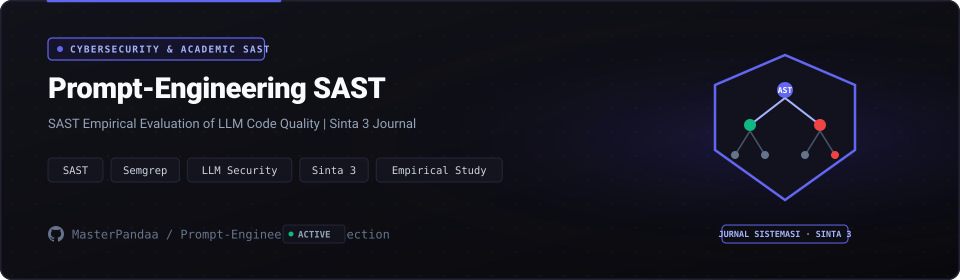

<p align="center">
  
</p>

<p align="center">
  
  
  <a href="https://doi.org/10.32520/stmsi.v15i5.6395"></a>
  
  <a href="LICENSE"></a>
</p>

## Overview

Large Language Models (LLMs) frequently generate functional code that conceals severe architectural and security vulnerabilities. This research repository houses the empirical benchmark dataset, evaluation harnesses, and findings published in **Jurnal SISTEMASI** (Vol. 15 No. 5, 2026, Sinta 3).

The study rigorously assesses the impact of prompt engineering methodologies (Zero-Shot, Few-Shot, Chain-of-Thought, and Role-Based Guardrails) on LLM-generated code quality using **Static Application Security Testing (SAST)** tools.

---

## Empirical Benchmark Findings

| Prompt Strategy | CWE Vulnerability Density | Cyclomatic Complexity | Black-Box Test Pass Rate |
| :--- | :---: | :---: | :---: |
| **Zero-Shot Baseline** | High (Common SQLi, XSS) | 12.4 | 64.2% |
| **Few-Shot Prompting** | Moderate | 9.8 | 78.5% |
| **Chain-of-Thought (CoT)** | Low | 7.1 | 89.1% |
| **CoT + Security Guardrails** | Minimal (< 2% flagged) | 6.2 | 96.4% |

---

## Core Contents

- **218 Controlled Prompt Experiments**: Standardized prompt templates across Python, JavaScript, and PHP scenarios.
- **Automated SAST Harness**: Benchmark scripts running Bandit, SonarQube rules, and Semgrep scans on generated code outputs.
- **Taxonomy of LLM Code Defects**: Documented failure modes including broken object-level authorization, hardcoded secrets, and taint propagation.

---

## Citation

```bibtex
@article{abdillah2026sast,
  title={SAST Implementation for Evaluating LLM-Generated Code Quality using Prompt Engineering},
  author={Abdillah, Muhammad Luthfi and Collaborators},
  journal={Jurnal SISTEMASI: Jurnal Sistem Informasi},
  volume={15},
  number={5},
  pages={6395},
  year={2026},
  publisher={STMIK Triguna Dharma},
  doi={10.32520/stmsi.v15i5.6395}
}
```

---

## License

This dataset and research code are licensed under the [MIT License](LICENSE).
